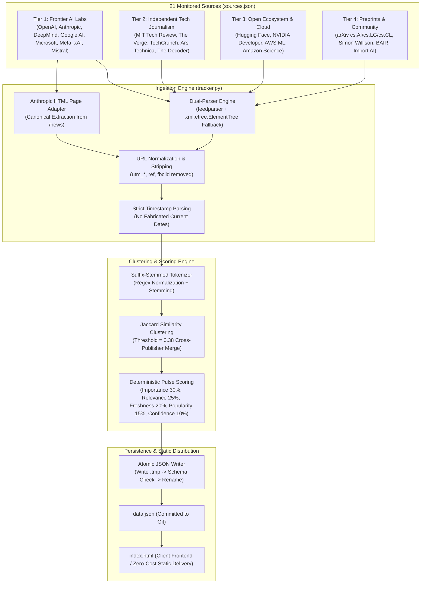

# 📡 AI Trend Pulse — Data Ingestion & Synthesis Pipeline

> **Complete architectural and engineering reference for data sources, dual-parser ingestion, page adapters, cross-publisher story clustering, algorithmic scoring, and automated hourly workflows.**

---

## 📑 Table of Contents
1. [Architecture Overview](#-architecture-overview)
2. [Source Registry (`sources.json`) & 4-Tier Hierarchy](#-source-registry-sourcesjson--4-tier-hierarchy)
3. [Dual-Parser Ingestion & Page Adapters](#-dual-parser-ingestion--page-adapters)
4. [Data Cleaning, Normalization & Provenance](#-data-cleaning-normalization--provenance)
5. [Story Deduplication & Jaccard Clustering](#-story-deduplication--jaccard-clustering)
6. [Algorithmic Pulse Scoring System](#-algorithmic-pulse-scoring-system)
7. [Categorized Slicing & Section Allocation](#-categorized-slicing--section-allocation)
8. [Atomic File Persistence & Resilient Fallbacks](#-atomic-file-persistence--resilient-fallbacks)
9. [Data Contract & Schema (`data.json`)](#-data-contract--schema-datajson)
10. [Automated Execution (GitHub Actions)](#-automated-execution-github-actions)

---

## 🏛️ Architecture Overview

The pipeline executes autonomously on an hourly schedule via GitHub Actions, driven by [`tracker.py`](tracker.py) and configured by [`sources.json`](sources.json). It ingests dispatches from 21 primary AI research laboratories, technology journalism desks, cloud providers, and preprint archives. Articles are normalized, clustered to eliminate cross-publisher duplication, scored according to algorithmic pulse weights, and written atomically to [`data.json`](data.json) for static client delivery.



---

## 🌐 Source Registry (`sources.json`) & 4-Tier Hierarchy

The sources are centralized in [`sources.json`](sources.json). Each entry adheres to the schema specified in Part 8 of the product brief:

```json
{
  "id": "openai_news",
  "name": "OpenAI News",
  "type": "rss",
  "url": "https://openai.com/news/rss.xml",
  "tier": 1,
  "tier_label": "Official Lab",
  "category": "ai_labs",
  "verification_status": "verified",
  "adapter": "default",
  "source_domain": "openai.com",
  "topics": ["Model Releases", "Research & Safety", "AI Coding"],
  "importance_weight": 1.0,
  "confidence_weight": 1.0,
  "max_items": 15
}
```

### Verified Sources Coverage (21 Monitored Feeds)
1. **Tier 1 (Official Labs)**:
   - OpenAI News (`openai.com/news/rss.xml`)
   - Anthropic Official News (`anthropic.com/news` via HTML adapter)
   - Anthropic Research Bridge (`hnrss.org/newest?q=anthropic.com` community discovery)
   - Google DeepMind Blog (`deepmind.google/blog/rss.xml`)
   - Google AI Blog (`blog.google/technology/ai/rss/`)
   - Microsoft AI Blog (`blogs.microsoft.com/ai/feed/`)
   - Mistral AI News (`mistral.ai/news/index.xml`)
2. **Tier 2 (Independent Tech Journalism)**:
   - MIT Technology Review (`technologyreview.com/topic/artificial-intelligence/feed/`)
   - The Verge AI (`theverge.com/rss/ai-artificial-intelligence/index.xml`)
   - TechCrunch AI (`techcrunch.com/category/artificial-intelligence/feed/`)
   - Ars Technica Lab (`feeds.arstechnica.com/arstechnica/technology-lab`)
   - The Decoder (`the-decoder.com/feed/`)
3. **Tier 3 (Open Research & Cloud Infrastructure)**:
   - Hugging Face Blog (`huggingface.co/blog/feed.xml`)
   - NVIDIA Developer Blog (`developer.nvidia.com/blog/feed`)
   - AWS Machine Learning Blog (`aws.amazon.com/blogs/machine-learning/feed/`)
   - Amazon Science (`amazon.science/index.rss`)
4. **Tier 4 (Community, Academic Preprints & Analysis)**:
   - arXiv Computer Science AI (`export.arxiv.org/rss/cs.AI`)
   - arXiv Machine Learning (`export.arxiv.org/rss/cs.LG`)
   - arXiv Computation and Language (`export.arxiv.org/rss/cs.CL`)
   - Simon Willison Weblog (`simonwillison.net/atom/entries/`)
   - Berkeley AI Research / BAIR (`bair.berkeley.edu/blog/feed.xml`)
   - Import AI by Jack Clark (`importai.substack.com/feed`)

---

## 🔌 Dual-Parser Ingestion & Page Adapters

### Dual-Parser Architecture
When ingesting standard RSS/Atom feeds, `tracker.py` employs a robust dual-parser approach:
1. **Primary**: Uses `feedparser` to parse XML and Atom syndication formats.
2. **Fallback**: If `feedparser` fails, throws an error, or encounters an XML parsing exception (e.g. malformed namespaces or unescaped entities), `tracker.py` automatically falls back to `xml.etree.ElementTree` via `_fallback_parse_xml_feed()`. It extracts `<item>` (RSS 2.0) and `<entry>` (Atom) tags directly using standard library tools, ensuring zero operational downtime even if external parsing libraries encounter issues.

### Anthropic HTML Page Adapter (`fetch_anthropic_official_news`)
Because `anthropic.com` does not expose a public RSS feed for its newsroom, `tracker.py` implements a canonical page adapter:
- Performs an HTTP `GET` request to `https://www.anthropic.com/news` with realistic browser headers (`User-Agent: Mozilla/5.0...`).
- Scans `<a>` tags for hrefs matching `/news/*`.
- Resolves relative URLs to canonical absolute links (`https://www.anthropic.com/news/...`).
- Converts slug text into human-readable headlines and extracts corresponding publication dates.
- Produces valid `ArticleItem` records that enter the identical downstream pipeline as standard feeds.

---

## 🧹 Data Cleaning, Normalization & Provenance

### URL Normalization (`normalize_url`)
To prevent duplicate stories caused by tracking query strings or URL fragment identifiers, `tracker.py` executes strict URL normalization:
- Strips advertising and analytics query parameters: `utm_source`, `utm_medium`, `utm_campaign`, `utm_term`, `utm_content`, `ref`, `fbclid`, `gclid`, `mc_cid`, `mc_eid`.
- Preserves functional query parameters (e.g. arXiv document IDs or search keys) required for article resolution.
- Strips URL fragments (`#...`) and normalizes trailing slashes.

### Strict Timestamp Integrity (`parse_published_datetime`)
To eliminate temporal hallucinations:
- Parses timestamps from RFC 822 (`feedparser.parsedate_to_datetime`) and ISO 8601 strings.
- Handles timezones correctly and converts timestamps to UTC.
- If a feed does not provide a parseable publication date, the field is set to `None` rather than fabricated with the current wall-clock time. In the UI, articles without verified dates are clearly displayed as "Recent".

---

## 🔗 Story Deduplication & Jaccard Clustering

When a major AI lab announces a breakthrough (e.g., a new model release), tech journalism outlets (The Verge, TechCrunch, Ars Technica) typically syndicate or report on the exact same event. Rather than showing 5 duplicate cards, `tracker.py` groups them into a cohesive story cluster:

### Suffix-Stemmed Tokenizer (`tokenize_title`)
1. Converts headlines to lowercase.
2. Strips common punctuation (`:`, `-`, `—`, `|`, `'`, `"`, `(`, `)`).
3. Filters out common English stop words (`the`, `a`, `an`, `and`, `or`, `in`, `on`, `at`, `to`, `for`, `with`, `of`, `by`, `from`, `is`, `are`, `was`, `new`, `ai`).
4. Applies suffix stemming (`stem_word`) to remove common inflectional endings (`ing`, `ed`, `ly`, `es`, `s`, `tion`, `al`, `ize`). For example: `standardizing` -> `standard`, `protocols` -> `protocol`.

### Cross-Publisher Clustering (`cluster_and_deduplicate_articles`)
- Calculates Jaccard similarity across token sets:
  $$J(A, B) = \frac{|A \cap B|}{|A \cup B|}$$
- If $J(A, B) \ge 0.38$, the articles are grouped into a single `StoryCluster`.
- The cluster selects its canonical lead article using strict editorial hierarchy:
  - Tier 1 (Official Lab) takes precedence over Tier 2 (Journalism), Tier 3 (Cloud), and Tier 4 (Community).
  - Among same-tier articles, the item with the richer description or earlier publication date is designated the canonical headline.
- Secondary URLs are retained in `evidence_urls` and `corroborating_sources`, providing readers with multi-source corroboration.

---

## ⚡ Algorithmic Pulse Scoring System

Stories are ranked using a multi-factor scoring formula:

$$\text{Score} = 0.30 \times \text{Importance} + 0.25 \times \text{Audience Relevance} + 0.20 \times \text{Freshness} + 0.15 \times \text{Popularity Signal} + 0.10 \times \text{Source Confidence}$$

### Component Calculations
1. **Importance ($w = 0.30$)**: Base weight derived from source tier (`1.0` for Tier 1 down to `0.85` for Tier 4) plus keyword bonuses for architectural breakthroughs (`weights`, `benchmark`, `frontier`, `api`, `safety`, `breakthrough`).
2. **Audience Relevance ($w = 0.25$)**: Keyword matching for practical developer and enterprise utility (`developer`, `coding`, `agent`, `sdk`, `inference`, `deploy`).
3. **Freshness ($w = 0.20$)**: Calculated via exponential decay with a 48-hour half-life:
   $$\text{Freshness} = \exp\left(-\frac{\Delta t_{\text{hours}}}{48}\right)$$
   Missing dates receive a neutral baseline score of $0.60$.
4. **Popularity Signal ($w = 0.15$)**: Computed based on multi-source corroboration:
   $$\text{Popularity} = \min\left(1.0, 0.40 + 0.25 \times (\text{corroboration\_count} - 1)\right)$$
5. **Source Confidence ($w = 0.10$)**: Direct tier weight assigned in `sources.json`.

---

## 📂 Categorized Slicing & Section Allocation

After scoring, clusters are partitioned into specialized sections in `data.json`:
- **`top_stories`**: Top 15 scored clusters formatted for chronological dispatches.
- **`trends`**: Top 6 clusters formatted as major curated developments with Why It Matters and key takeaways.
- **`pulse_items`**: Top 8 high-velocity developments for the top pulse strip.
- **`ai_tools`**: Practical consumer tools, user workflows, and app releases.
- **`dev_radar`**: Coding agents, APIs, open weights, benchmarks, and infrastructure.
- **`research_safety`**: Frontier alignment, preprints, evals, and governance policies.

---

## 🛡️ Atomic File Persistence & Resilient Fallbacks

### Atomic Disk Replacement (`atomic_write_json`)
To eliminate the risk of serving corrupted or partial JSON files to client browsers:
1. The serialized payload is written to a temporary file in the same directory (`data.json.tmp.<pid>`).
2. The file is flushed to disk (`flush()`) and verified via `os.fsync()`.
3. An integrity check confirms the temporary file contains valid JSON and non-empty sections.
4. An atomic rename (`os.replace()`) overwrites `data.json`. On POSIX systems, `os.replace` is guaranteed atomic.

### Safe Fallback Mechanisms
If upstream network connectivity fails or an external feed is unreachable:
1. `tracker.py` catches the network exception.
2. If `data.json` already exists and contains valid data, the existing dataset is preserved and marked with `data_status: "cached_fallback"`. The previous `generated_at` timestamp is retained to maintain provenance.
3. If no cached file exists, a non-LLM `raw_headlines` fallback is generated directly from the available feeds with zero fabricated content.

---

## 📋 Data Contract & Schema (`data.json`)

The final payload written to `data.json` matches the following contract:

```json
{
  "generated_at": "2026-11-01T03:15:00.000000+00:00",
  "data_status": "fresh_intelligence",
  "sources_monitored": 21,
  "articles_ingested": 95,
  "clusters_formed": 95,
  "top_stories": [...],
  "trends": [...],
  "pulse_items": [...],
  "ai_tools": [...],
  "dev_radar": [...],
  "research_safety": [...]
}
```

---

## 🔄 Automated Execution (GitHub Actions)

The pipeline is automated via `.github/workflows/update.yml`:
- **Schedule**: Executes on an hourly cron (`0 * * * *`).
- **Trigger**: Also supports manual triggers via `workflow_dispatch`.
- **Steps**:
  1. Checkouts repository.
  2. Sets up Python 3.10 and Node.js 20.
  3. Installs dependencies (`pip install -r requirements.txt`).
  4. Runs backend data refresh (`python3 tracker.py`).
  5. Executes automated test suite (`npm test`).
  6. Commits and pushes updated `data.json` if changes are detected.
