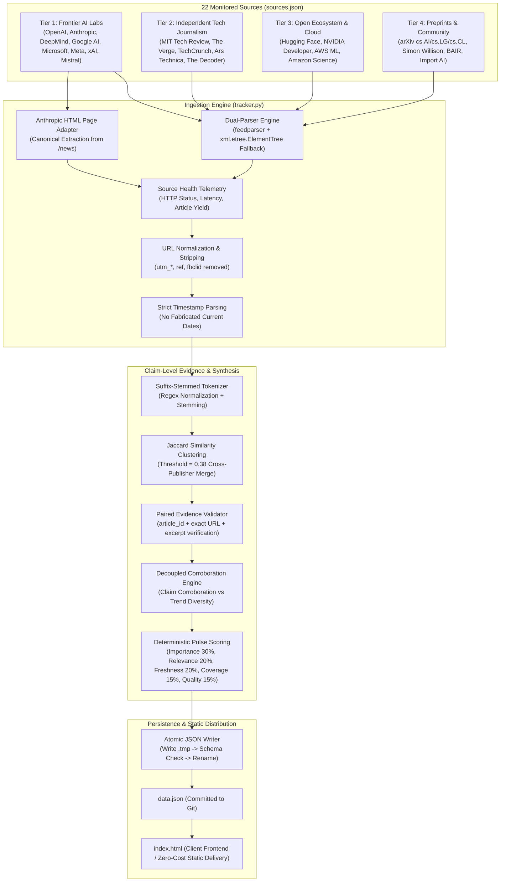

# 📡 AI Trend Pulse — Data Ingestion & Synthesis Pipeline

> **Complete architectural and engineering reference for data sources, dual-parser ingestion, page adapters, cross-publisher story clustering, algorithmic scoring, and automated hourly workflows.**

---

## 📑 Table of Contents
1. [Architecture Overview](#-architecture-overview)
2. [Source Registry (`sources.json`) & 4-Tier Hierarchy](#-source-registry-sourcesjson--4-tier-hierarchy)
3. [Dual-Parser Ingestion & Page Adapters](#-dual-parser-ingestion--page-adapters)
4. [Data Cleaning, Normalization & Provenance](#-data-cleaning-normalization--provenance)
5. [Story Deduplication & Jaccard Clustering](#-story-deduplication--jaccard-clustering)
6. [Algorithmic Pulse Scoring System](#-algorithmic-pulse-scoring-system)
7. [Categorized Slicing & Section Allocation](#-categorized-slicing--section-allocation)
8. [Atomic File Persistence & Resilient Fallbacks](#-atomic-file-persistence--resilient-fallbacks)
9. [Data Contract & Schema (`data.json`)](#-data-contract--schema-datajson)
10. [Automated Execution (GitHub Actions)](#-automated-execution-github-actions)

---

## 🏛️ Architecture Overview

The pipeline executes autonomously on an hourly schedule via GitHub Actions, driven by [`tracker.py`](tracker.py) and configured by [`sources.json`](sources.json). It ingests dispatches from 22 primary AI research laboratories, technology journalism desks, cloud providers, and preprint archives. Articles are normalized, monitored with end-to-end telemetry, clustered to eliminate cross-publisher duplication, verified through paired claim-level evidence references, scored according to algorithmic pulse weights, and written atomically to [`data.json`](data.json) for static client delivery.



---

## 🌐 Source Registry (`sources.json`) & 4-Tier Hierarchy

The sources are centralized in [`sources.json`](sources.json). Each entry adheres to the schema validated by `validate_source_record`:

```json
{
  "source_id": "openai_news",
  "name": "OpenAI News",
  "canonical_listing_url": "https://openai.com/news",
  "feed_url": "https://openai.com/news/rss.xml",
  "source_type": "official",
  "trust_tier": 1,
  "confidence_score": 100,
  "is_official": true,
  "feed_is_official": true,
  "fetch_method": "rss",
  "enabled": true,
  "poll_interval_minutes": 60,
  "publisher_id": "openai",
  "publisher_group_id": "openai",
  "is_primary_source": true,
  "publisher_owns_feed": true
}
```

### Verified Sources Coverage (22 Monitored Feeds)
1. **Tier 1 (Official Labs & Frontier Developers)**:
   - OpenAI News (`openai.com/news/rss.xml`)
   - Anthropic Official News (`anthropic.com/news` via HTML adapter)
   - Anthropic Research Bridge (`hnrss.org/newest?q=anthropic.com` community discovery)
   - Google DeepMind Blog (`deepmind.google/blog/rss.xml`)
   - Google AI Blog (`blog.google/technology/ai/rss/`)
   - Microsoft AI Blog (`blogs.microsoft.com/ai/feed/`)
   - Mistral AI News (`mistral.ai/news/index.xml`)
2. **Tier 2 (Independent Tech Journalism)**:
   - MIT Technology Review (`technologyreview.com/topic/artificial-intelligence/feed/`)
   - The Verge AI (`theverge.com/rss/ai-artificial-intelligence/index.xml`)
   - TechCrunch AI (`techcrunch.com/category/artificial-intelligence/feed/`)
   - Ars Technica Lab (`feeds.arstechnica.com/arstechnica/technology-lab`)
   - The Decoder (`the-decoder.com/feed/`)
3. **Tier 3 (Open Research & Cloud Infrastructure)**:
   - Hugging Face Blog (`huggingface.co/blog/feed.xml`)
   - NVIDIA Developer Blog (`developer.nvidia.com/blog/feed`)
   - AWS Machine Learning Blog (`aws.amazon.com/blogs/machine-learning/feed/`)
   - Amazon Science (`amazon.science/index.rss`)
4. **Tier 4 (Community, Academic Preprints & Analysis)**:
   - arXiv Computer Science AI (`export.arxiv.org/rss/cs.AI`)
   - arXiv Machine Learning (`export.arxiv.org/rss/cs.LG`)
   - arXiv Computation and Language (`export.arxiv.org/rss/cs.CL`)
   - Simon Willison Weblog (`simonwillison.net/atom/entries/`)
   - Berkeley AI Research / BAIR (`bair.berkeley.edu/blog/feed.xml`)
   - Import AI by Jack Clark (`importai.substack.com/feed`)

---

## 🔌 Dual-Parser Ingestion & Page Adapters

### Dual-Parser Architecture
When ingesting standard RSS/Atom feeds, `tracker.py` employs a robust dual-parser approach:
1. **Primary**: Uses `feedparser` to parse XML and Atom syndication formats.
2. **Fallback**: If `feedparser` fails, throws an error, or encounters an XML parsing exception (e.g. malformed namespaces or unescaped entities), `tracker.py` automatically falls back to `xml.etree.ElementTree` via `_fallback_parse_xml_feed()`. It extracts `<item>` (RSS 2.0) and `<entry>` (Atom) tags directly using standard library tools, ensuring zero operational downtime even if external parsing libraries encounter issues.

### Anthropic HTML Page Adapter (`fetch_anthropic_official_news`)
Because `anthropic.com` does not expose a public RSS feed for its newsroom, `tracker.py` implements a canonical page adapter:
- Performs an HTTP `GET` request to `https://www.anthropic.com/news` with realistic browser headers (`User-Agent: Mozilla/5.0...`).
- Scans `<a>` tags for hrefs matching `/news/*`.
- Resolves relative URLs to canonical absolute links (`https://www.anthropic.com/news/...`).
- Converts slug text into human-readable headlines and extracts corresponding publication dates.
- Produces valid `ArticleItem` records that enter the identical downstream pipeline as standard feeds.

---

## 🧹 Data Cleaning, Normalization & Provenance

### URL Normalization (`normalize_url`)
To prevent duplicate stories caused by tracking query strings or URL fragment identifiers, `tracker.py` executes strict URL normalization:
- Strips advertising and analytics query parameters: `utm_source`, `utm_medium`, `utm_campaign`, `utm_term`, `utm_content`, `ref`, `fbclid`, `gclid`, `mc_cid`, `mc_eid`.
- Preserves functional query parameters (e.g. arXiv document IDs or search keys) required for article resolution.
- Strips URL fragments (`#...`) and normalizes trailing slashes.

### Strict Timestamp Integrity (`parse_published_datetime`)
To eliminate temporal hallucinations:
- Parses timestamps from RFC 822 (`feedparser.parsedate_to_datetime`) and ISO 8601 strings.
- Handles timezones correctly and converts timestamps to UTC.
- If a feed does not provide a parseable publication date, the field is set to `None` rather than fabricated with the current wall-clock time. In the UI, articles without verified dates are clearly displayed as "Recent".

---

## 🔍 Claim-Level Evidence Architecture & Provenance Verification

AI Trend Pulse implements strict claim-level evidence verification to prevent confounding articles covering distinct developments with independent evidence supporting the same factual claim:

### Paired Evidence Object Contract
Every supporting evidence reference is structured as an atomic object:
```json
{
  "article_id": "art_openai_123456789abc",
  "canonical_url": "https://openai.com/example",
  "publisher_group_id": "openai",
  "supporting_excerpt": "Direct quotation or verbatim summary sentence",
  "text_verified": true
}
```

### Provenance Validation Rules (`validate_evidence_provenance`)
1. **Article ID Existence**: The `article_id` must strictly exist within the collected raw article dataset.
2. **Exact Canonical URL Equality**: The normalized URL of the evidence reference must exactly match the normalized canonical URL of that specific `article_id`. URL prefix matching is eliminated.
3. **Mismatched Pair Rejection**: If an AI model outputs an `article_id` belonging to story A and a `canonical_url` belonging to story B, the validator flags the mismatch and rejects the reference.
4. **Synthesis Input Guard**: Citations referencing articles not present in the Gemini prompt synthesis input are rejected.
5. **Trusted Publisher Group Resolution**: Publisher grouping (`publisher_group_id`) is resolved strictly from trusted source metadata in `sources.json`, never from model generation.
6. **Excerpt Verification (`verify_supporting_excerpt`)**: The supporting text excerpt is validated against the article's title and summary using token-overlap containment; ungrounded quotes are flagged (`text_verified = false`).

### Decoupled Claim Corroboration vs Trend Signal Diversity
- **Trend Types**:
  - `single_development`: A coherent real-world event or product release. Corroboration requires multiple independent non-discovery publisher groups reporting the exact same event.
  - `emerging_theme`: Connects multiple distinct developments into a broader industry pattern. Supported by an explicit `theme_relationship` explanation.
- **Corroboration Metrics**:
  - `claim_corroboration`: The number of distinct corporate publisher groups confirming a specific factual claim.
  - `trend_signal_diversity`: The total number of distinct constituent developments/articles contributing to an emerging theme.
  - Distinct developments (e.g. AWS logistics and Legora legal diligence) contribute to signal diversity, but do **NOT** artificially inflate claim corroboration counts.

---

## 🔗 Story Deduplication & Jaccard Clustering

When a major AI lab announces a breakthrough (e.g., a new model release), tech journalism outlets (The Verge, TechCrunch, Ars Technica) typically syndicate or report on the exact same event. Rather than showing 5 duplicate cards, `tracker.py` groups them into a cohesive story cluster:

### Suffix-Stemmed Tokenizer (`tokenize_title`)
1. Converts headlines to lowercase.
2. Strips common punctuation (`:`, `-`, `—`, `|`, `'`, `"`, `(`, `)`).
3. Filters out common English stop words (`the`, `a`, `an`, `and`, `or`, `in`, `on`, `at`, `to`, `for`, `with`, `of`, `by`, `from`, `is`, `are`, `was`, `new`, `ai`).
4. Applies suffix stemming (`stem_word`) to remove common inflectional endings (`ing`, `ed`, `ly`, `es`, `s`, `tion`, `al`, `ize`). For example: `standardizing` -> `standard`, `protocols` -> `protocol`.

### Cross-Publisher Clustering (`cluster_and_deduplicate_articles`)
- Calculates Jaccard similarity across token sets:
  $$J(A, B) = \frac{|A \cap B|}{|A \cup B|}$$
- If $J(A, B) \ge 0.38$, the articles are grouped into a single `StoryCluster`.
- The cluster selects its canonical lead article using strict editorial hierarchy:
  - Tier 1 (Official Lab) takes precedence over Tier 2 (Journalism), Tier 3 (Cloud), and Tier 4 (Community).
  - Among same-tier articles, the item with the richer description or earlier publication date is designated the canonical headline.
- Secondary URLs are retained in `evidence_urls` and `corroborating_sources`, providing readers with multi-source corroboration.

---

## ⚡ Algorithmic Pulse Scoring System

Stories are ranked using a multi-factor scoring formula:

$$\text{Pulse Score} = 0.30 \times \text{Importance} + 0.20 \times \text{Audience Relevance} + 0.20 \times \text{Freshness} + 0.15 \times \text{Coverage Corroboration} + 0.15 \times \text{Source Quality}$$

### Component Calculations
1. **Importance ($w = 0.30$)**: Measures architectural significance, benchmark capability jumps, reasoning advances, safety framework updates, and API releases. Safety, security, alignment, and policy stories receive a guaranteed minimum protected importance score of 75.
2. **Audience Relevance ($w = 0.20$)**: Evaluates practical developer utility and enterprise application value (`developer`, `coding`, `agent`, `sdk`, `inference`, `deploy`).
3. **Freshness ($w = 0.20$)**: Calculated via time-decay anchored to verified publication timestamps; stories with missing dates receive a neutral baseline score of 50.
4. **Coverage & Corroboration ($w = 0.15$)**: Grounded strictly in distinct corporate publisher groups. Multiple stories or feeds from the same parent organization (e.g. Google DeepMind + Google AI) count as one publisher group; community discovery channels do not count as independent press.
5. **Source Quality & Authority ($w = 0.15$)**: Verification weight determined by the tier classification of the primary publishing entity (Tier 1 = 100, Tier 2 = 85, Tier 3 = 80, Tier 4 = 65).

---

## ✍️ Editorial Grounding & Epistemic Boundaries

Every story is generated with rich, grounded editorial fields to eliminate generic boilerplate summaries:
- **`reported_facts`**: Bulleted list of confirmed, source-grounded factual developments extracted from raw text.
- **`what_changed`**: Clear plain-English explanation of technical shifts, model releases, or policy changes.
- **`why_it_matters`**: Real-world strategic significance grounded in domain impact.
- **`potential_impact`**: Explicitly labeled analytical projection regarding developer workflows or market dynamics.
- **`analysis_limitations`**: Epistemic verification boundaries (e.g. single-source developer claims, missing independent benchmarks, or preprint status).

---

## 📊 End-to-End Ingestion Health Telemetry & 5 Operating Cases

`tracker.py` monitors health across all 22 configured feeds, recording per-source metrics (`fetch_status`, `http_status`, `articles_received`, `articles_accepted`, `last_attempt_at`, `last_success_at`, `error_type`).

### Five Operating Cases
1. **Case A (Normal Cycle)**: Monitored sources respond successfully, fresh articles are ingested, scored, and published. Status: `healthy`.
2. **Case B (Valid Zero Articles)**: Upstream sources respond successfully with HTTP 200, but no new articles were published within the ingestion window. Pipeline updates `last_attempt_at` and telemetry, preserves verified stories, and exits cleanly with code `0`.
3. **Case C (Partial Degradation)**: Transient upstream errors (e.g. 5xx responses or timeouts) affect a subset of feeds. Pipeline logs diagnostics, marks status `degraded`, processes available feeds, and succeeds.
4. **Case D (Total Upstream Failure)**: All enabled sources fail (e.g. network disconnect or upstream blockage). Pipeline preserves the last-known-good dataset, cleans up `.tmp` files, logs traceback, and raises `PipelineExecutionError`, causing GitHub Actions to fail and alert maintainers.
5. **Case E (All Content Filtered)**: Sources return articles, but all are filtered by freshness or relevance thresholds. Pipeline preserves existing stories, updates telemetry with `all_content_filtered`, and exits cleanly.

---

## 📋 Data Contract & Schema (`data.json`)

The final payload written to `data.json` adheres to the comprehensive production schema:

```json
{
  "schema_version": 2,
  "generated_at": "2026-11-01T12:00:00.000000+00:00",
  "data_status": "fresh_intelligence",
  "sources_monitored": 22,
  "source_health_summary": {
    "status": "healthy",
    "configured_sources_count": 22,
    "enabled_sources_count": 22,
    "successful_fetches_count": 22,
    "failed_fetches_count": 0,
    "fresh_articles_accepted_count": 45
  },
  "source_health_details": [...],
  "top_stories": [
    {
      "article_id": "art_openai_123456789abc",
      "title": "Headline",
      "summary": "Plain English summary",
      "reported_facts": ["Fact 1", "Fact 2"],
      "what_changed": "Technical shift",
      "why_it_matters": "Domain significance",
      "potential_impact": "Analytical projection",
      "analysis_limitations": "Epistemic bounds",
      "publisher_group_id": "openai",
      "trust_tier": 1,
      "is_official": true,
      "overall_score": 88
    }
  ],
  "trends": [
    {
      "title": "Lead Development or Emerging Theme",
      "trend_type": "emerging_theme",
      "theme_relationship": "Cross-cutting synthesis",
      "claims": [
        {
          "claim_id": "cl_1",
          "text": "Specific factual claim",
          "evidence": [
            {
              "article_id": "art_openai_123456789abc",
              "canonical_url": "https://openai.com/example",
              "publisher_group_id": "openai",
              "supporting_excerpt": "Quotation",
              "text_verified": true
            }
          ],
          "claim_corroboration": 1,
          "verification_status": "official_announcement"
        }
      ],
      "trend_signal_diversity": 2,
      "claim_corroboration": 1
    }
  ],
  "pulse_items": [...],
  "ai_tools": [...],
  "dev_radar": [...],
  "research_safety": [...]
}
```

---

## 🔄 Automated Execution (GitHub Actions)

The pipeline is automated via `.github/workflows/update.yml`:
- **Schedule**: Executes on an hourly cron (`0 * * * *`).
- **Trigger**: Also supports manual triggers via `workflow_dispatch`.
- **Steps**:
  1. Checkouts repository.
  2. Sets up Python 3.10 and Node.js 20.
  3. Installs dependencies (`pip install -r requirements.txt`).
  4. Runs backend data refresh (`python3 tracker.py`).
  5. Executes automated test suite (`npm test`).
  6. Commits and pushes updated `data.json` if changes are detected.
